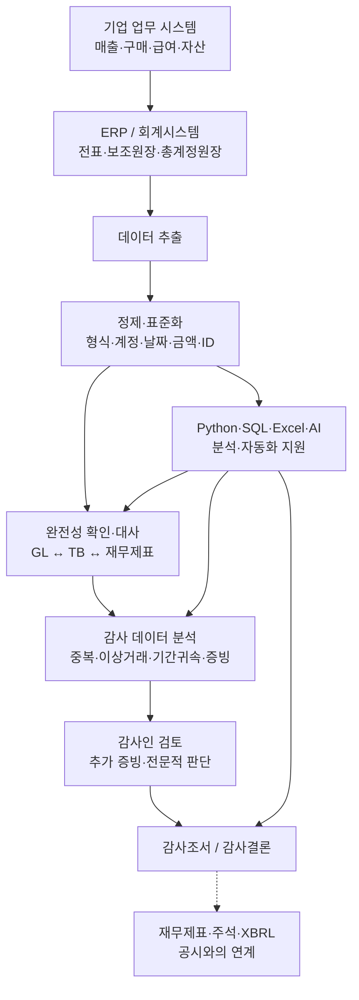

# Audit Data Lab

**회계감사 실무와 Data Analytics – IT Specialist 단계별 데이터 분석 프로젝트**

`Python` · `pandas` · `SQL / SQLite` · `Excel / openpyxl` · `OpenDART API` · `XBRL / XML` · `unittest`

EY한영 감사부문 인턴 직무를 지원하면서 회계감사에서 어떤 데이터를 다루고 IT로 무엇을 검증하는지 궁금해졌습니다. 공개된 감사업무 자료를 바탕으로 거래·회계 데이터를 구성하고, 전표 추적부터 장부 대사, 예외 거래 검토, 재무제표 검증과 공시 데이터 분석을 진행했습니다.

## Key Results

|   전표 검증   | 감사검토조서 |        재무제표 검증         |            실제 공시 분석             |   자동 테스트    |
| :-----------: | :----------: | :--------------------------: | :-----------------------------------: | :--------------: |
| **21개** 전표 | **3건** 정리 | **28개** 검사 / **5개** 경고 | **229행** API / **4,877개** XBRL Fact | **19 / 19** 통과 |

## 01. Audit Data Workflow

**회계 데이터의 생성 → 감사 데이터 분석 → 검토·문서화 흐름**입니다.



**실습 범위:** Task 01–10은 **교육용 가상 ERP·회계 데이터**로 전표·원장·증빙 대사와 예외 탐지를 구현했습니다. Task 11은 **삼성전자 실제 공개 공시 데이터**를 조회하고 XBRL 구조를 분석했습니다.

## 02. Data Sources

| 데이터                                    | 주요 항목                                 | 활용 목적                         |
| ----------------------------------------- | ----------------------------------------- | --------------------------------- |
| [ERP 매출 데이터](data/raw/erp_sales.csv) | 거래 ID, 고객, 거래일, 매출금액           | 거래와 회계 기록의 연결 이해      |
| [청구·인도·입금 자료](data/raw/)          | Invoice ID, 인도일, 입금일, 청구·입금금액 | 매출 발생·누락·기간귀속 검토      |
| 전표 헤더·상세 (`data/derived/`)          | 전표번호, 계정코드, 차변·대변             | 분개 추적, 차대변 검증, 중복 확인 |
| 총계정원장·시산표 (`data/derived/`)       | 계정별 잔액, 거래 참조                    | GL 집계 및 청구서·재무제표 대사   |
| [결산 시나리오](data/mission10/)          | 추가 전표, 재무제표 초안                  | 푸팅 및 GL–재무제표 검증          |
| [OpenDART·XBRL 예제](data/mission11/)     | 계정 ID, 기간, 통화 단위, Fact            | 공시 데이터 파싱과 구조 분석      |

`data/derived/`는 `run_gl.py` 실행 시 생성됩니다. 실제 공시 조회 결과와 Excel 검토조서는 `reports/`에 저장됩니다.

## 03. Technologies & Applications

| 기술                    | 프로젝트에서 수행한 작업                                           |
| ----------------------- | ------------------------------------------------------------------ |
| **Python / pandas**     | CSV 로딩, JOIN·`merge`, `groupby` 집계, 중복·미매칭·금액 차이 탐지 |
| **SQL / SQLite**        | 전표·총계정원장 관계형 조회, 계정별 집계·검증                      |
| **Excel / openpyxl**    | 검토 대상·상태·차이금액을 Excel 감사검토조서 초안으로 생성         |
| **OpenDART API / JSON** | 삼성전자 2025년 연결재무제표 조회, 계정별 금액 추출·비교           |
| **XBRL / XML**          | 숫자 Fact 및 `concept`·`contextRef`·`unitRef` 추출                 |
| **unittest / Git**      | 검증 로직 19개 테스트 및 기능별 변경 이력 관리                     |

## 04. Tasks — Click to Explore

| Task                                                                     | 검증 질문                                | 주요 결과                                   |
| ------------------------------------------------------------------------ | ---------------------------------------- | ------------------------------------------- |
| [01. Journal Entry Trace](01-journal-entry-trace.py)                     | 매출 거래는 어떻게 분개되는가?           | J-1001 매출채권·매출 **각 120만 원** 추적   |
| [02. Journal Balance Validation](02-journal-balance-validation.py)       | 모든 전표의 차변·대변이 일치하는가?      | 가상 전표 **21개** 검증                     |
| [03. Duplicate Revenue Detection](03-duplicate-revenue-detection.py)     | 동일 청구서가 여러 전표에 기록됐는가?    | `INV-007` 중복 참조 식별                    |
| [04. Revenue Impact Analysis](04-revenue-impact-analysis.py)             | 중복 기록의 잠재적 금액 영향은?          | **78만 원** 중복 가능 금액 분석             |
| [05. Invoice–Ledger Reconciliation](05_invoice_ledger_reconciliation.py) | 청구서와 원장 금액이 일치하는가?         | `INV-007/009/012` 검토 후보 추출            |
| 06. Audit Evidence Review                                                | 금액 차이를 어떤 증빙으로 확인할까?      | `INV-009` 추가 확인 질문 정리               |
| [07. Workpaper Automation](07_workpaper_automation.py)                   | 검토 결과를 자동으로 문서화할 수 있는가? | Excel 검토조서 **3건** 생성                 |
| 08. Missing Revenue Investigation                                        | 청구서는 있는데 GL에 매출이 없다면?      | `INV-012` 완전성·기간귀속 검토              |
| [09. Revenue Cut-off Testing](09_revenue_cutoff_testing.py)              | 매출이 올바른 기간에 기록됐는가?         | `INV-006` 등 결산일 전후 거래 점검          |
| [10. Financial Statement Tie-out](10_financial_statement_tieout.py)      | GL·TB·재무제표 금액이 일치하는가?        | **28개 검사 / 5개 경고**                    |
| [11. OpenDART & XBRL](11_opendart_xbrl_analysis.py)                      | 실제 공시 숫자는 어떤 구조인가?          | **API 229행 / XBRL 숫자 Fact 4,877개** 분석 |

_Task 06·08은 별도 실행 파일이 아닌 검토·해석 과제입니다. 가상 데이터의 이상징후는 추가 검토 대상입니다._

## 05. Run Locally

```bash
python3 -m venv .venv
source .venv/bin/activate
python -m pip install -r requirements.txt

# 가상 ERP 분석 및 전표·GL 생성
python run_audit.py
python run_gl.py

# 개별 과제 실행 예시
python 01-journal-entry-trace.py
python 05_invoice_ledger_reconciliation.py
python 07_workpaper_automation.py
python 09_revenue_cutoff_testing.py
python 10_financial_statement_tieout.py

# OpenDART 예제 데이터 분석
python 11_opendart_xbrl_analysis.py --mode demo

# 전체 테스트
python -m unittest discover -s tests -v
```

**실제 OpenDART 공시 조회**

```bash
export DART_API_KEY='YOUR_API_KEY'
python 11_opendart_xbrl_analysis.py --mode live --corp-code 00126380 --year 2025 --fs-div CFS --xbrl
```
