# Audit Data Lab

**회계감사 데이터는 어떻게 검증할까? — ERP 거래, 총계정원장, 재무제표, XBRL까지 직접 다뤄본 데이터 분석 실습**

`Python` · `pandas` · `SQL / SQLite` · `Excel / openpyxl` · `OpenDART API` · `XBRL / XML` · `unittest`

EY한영 감사부문 **Data Analytics – IT Specialist** 인턴 직무를 지원하면서 시작한 프로젝트입니다. 감사인이 활용하는 회계 데이터가 어떤 구조인지 이해하고자 **전표 추적 → 원장·증빙 대사 → 예외 후보 분석 → 검토조서 자동화 → 재무제표 검증**을 구현했습니다.

> **실습 데이터:** Task 01–10은 교육용 가상 ERP 데이터, Task 11은 삼성전자 **2025년 공개 연결재무제표**를 사용한 별도 분석입니다.

## ✨ At a Glance

| 전표 균형검사 | 청구서 검토 대상 |      재무제표 검증       |             공개 공시 데이터              |  자동 테스트   |
| :-----------: | :--------------: | :----------------------: | :---------------------------------------: | :------------: |
|   **21건**    |     **3건**      | **28개 규칙 / 5개 경고** | **229개 API 행 / 4,877개 XBRL 숫자 Fact** | **19/19 통과** |

### Contents

## 📊 실제 실행 결과 및 산출물

교육용 가상 ERP 데이터를 Python·SQL로 분석하고, 청구서·총계정원장 대사 및 재무제표 검증 결과를 Excel 검토조서 초안으로 자동 생성했습니다.

### 1. 청구서·매출 원장 대사 및 검토조서

12개 청구서를 매출 원장과 대사하여 중복 전표 참조, 금액 불일치, 원장 미매칭 거래 등 검토 대상 3건을 식별했습니다. 매칭된 거래의 금액 차이 합계는 980,000원이며, 각 거래에 필요한 추가 증빙과 검토 상태를 정리했습니다.

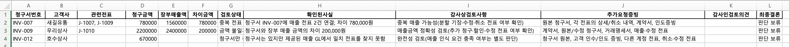

**분석 요약**

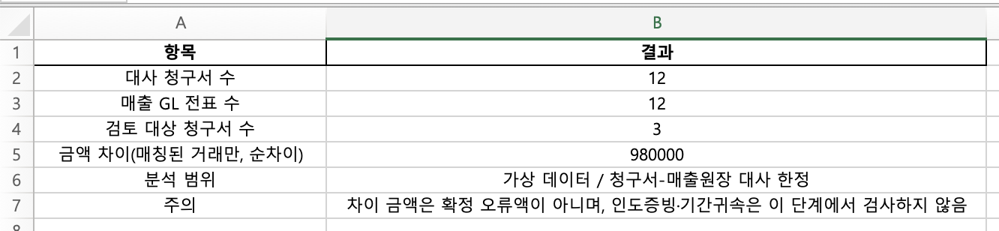

**청구서·매출 원장 대사 상세**

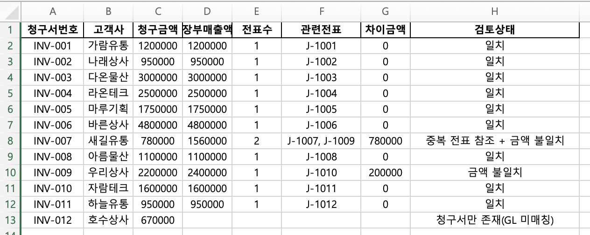

### 2. 재무제표 검증 및 감사검토조서

총계정원장(GL)과 시산표(TB), 재무제표 초안을 연결해 28개 검증 항목을 점검했습니다. 5개 차이 항목을 식별하고, 주요 차이 원인 2종과 추가 확인 사항을 Excel 검토조서에 정리했습니다.

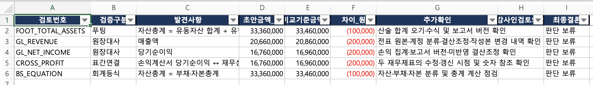

**검증 결과 요약**

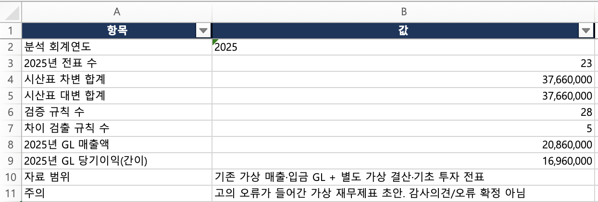

**2025년 시산표**

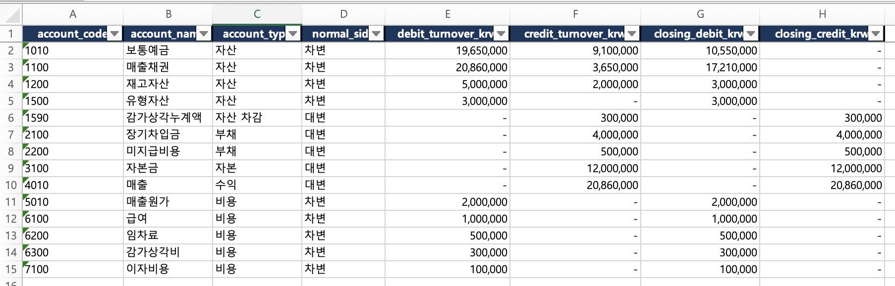

**재무제표 초안**

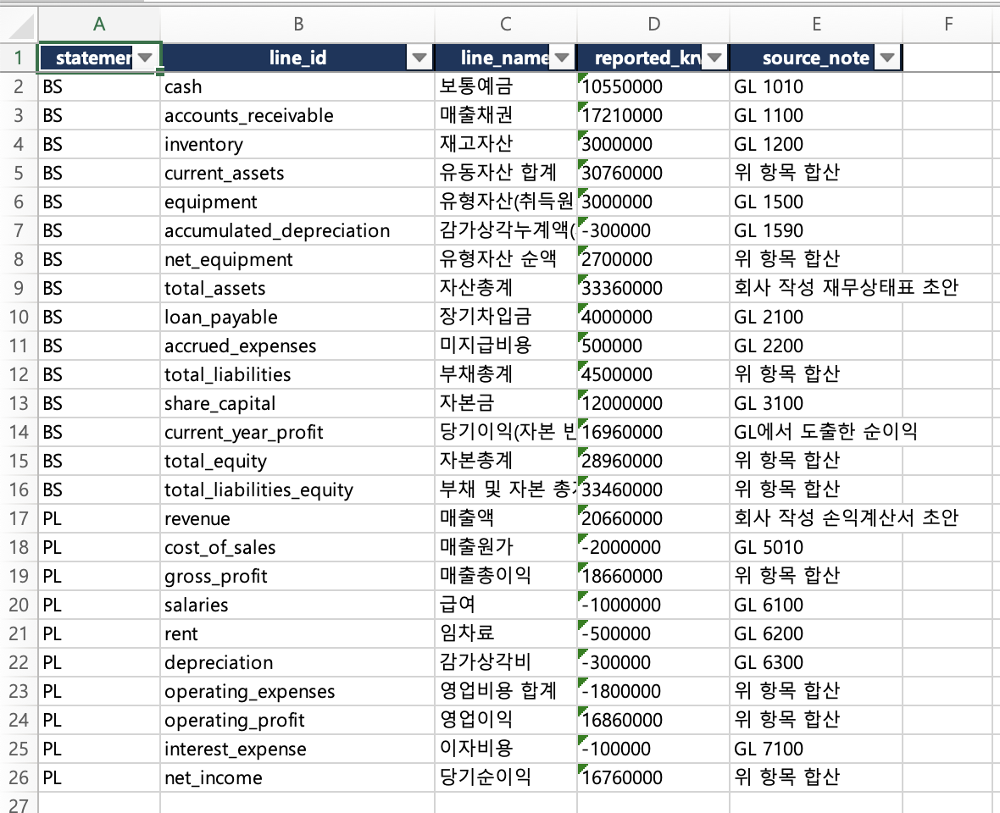

**28개 검증 항목 상세**

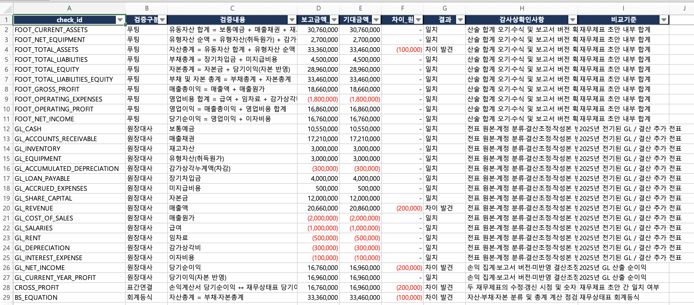

### 3. Python 실행 및 검증 결과

**① 전표·총계정원장 생성**

21개 전표의 차변·대변 균형을 검증하고 2025년 시산표를 생성했습니다.

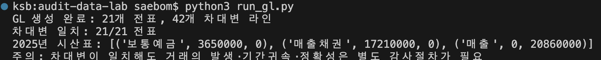

**② 청구서·원장 대사**

청구서와 매출 원장을 비교해 중복 기록, 금액 불일치, 원장 미매칭 거래를 식별했습니다.

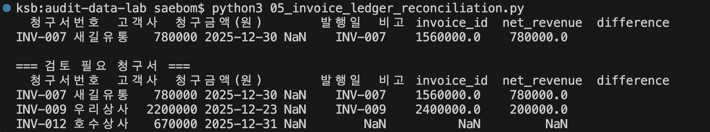

**③ 재무제표 검증 자동화**

총 28개 항목을 검증해 5개 차이 항목을 확인하고 Excel 검토조서 초안을 생성했습니다.

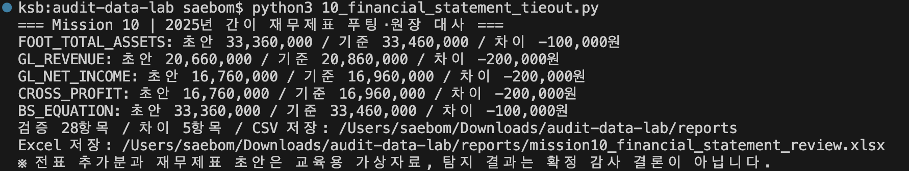

> **분석 범위:** 모든 ERP 거래 및 재무제표 검증 자료는 교육용 가상 데이터입니다. 탐지된 차이는 추가 검토 대상이며, 실제 회계 오류나 감사 결론으로 확정한 것은 아닙니다.

### 4. 자동 테스트 — 19개 통과

`unittest`를 활용해 전표 균형, 중복 매출 탐지, 시산표 검증, 경고 중복 집계 방지, XBRL 계정·기간·단위 처리 등 핵심 로직을 테스트했습니다.

**결과: 19 tests / 19 passed**

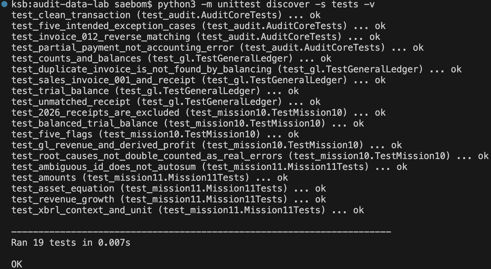

### 5. OpenDART 실제 공시 데이터 분석

OpenDART API를 통해 삼성전자 2025년 연결재무제표를 조회하고, 계정·기간·단위 정보를 기준으로 재무 데이터를 분석했습니다.

- **재무제표 조회:** 229개 행
- **핵심 계정 매핑:** 6/6개
- **자동 검증:** 재무상태표 회계등식, 전기 비교 등 3개 항목 PASS
- **XBRL 구조 분석:** 숫자 Fact 4,877개 추출 및 구조 파싱

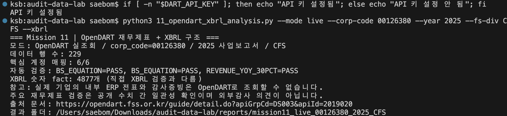

📥 [청구서 감사검토조서 Excel 파일](sample_outputs/mission07_audit_workpaper.xlsx)

📥 [재무제표 검증 Excel 파일](sample_outputs/mission10_financial_statement_review.xlsx)

> 실제 공개 공시자료를 활용한 데이터 구조 및 수치 일관성 검토이며, 내부 ERP 데이터 감사나 외부감사를 수행한 것은 아닙니다.

- [01. Audit Data Workflow](#01-audit-data-workflow)
- [02. Data and Tech Stack](#02-data-and-tech-stack)
- [03. Audit Checks](#03-audit-checks)
- [04. Year-end Validation](#04-year-end-validation)
- [05. OpenDART and XBRL](#05-opendart-and-xbrl)
- [06. All Tasks](#06-all-tasks)
- [07. Run and Test](#07-run-and-test)

---

## 01. Audit Data Workflow

공개된 감사업무 자료를 바탕으로 이해한 **기업의 거래 기록 → 감사 데이터 준비 → 검증·분석 → 후속 검토** 흐름입니다. 이 중 데이터 처리·대사·예외 후보 추출·문서화를 교육용으로 구현했습니다.

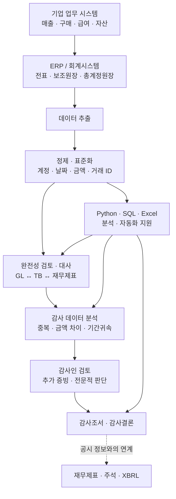

**실습에서 다룬 데이터 경로**

```text
data/raw/ (매출 · 청구서 · 인도 · 입금)
      │  load_raw() / 필드 표준화
      ▼
전표 헤더 + 전표 상세 → General Ledger(GL) → Trial Balance(TB)
      │                       │
      │                       └── 재무제표 초안 · 푸팅/계정 대사 [Task 10]
      └── 청구서·인도 자료 대사 → 중복 / 금액 차이 / 기간귀속 검사
                                    └── Excel 검토조서 [Task 07]

[독립적인 공개자료 실습] OpenDART API → JSON 재무제표 / XBRL XML [Task 11]
```

## 02. Data and Tech Stack

### Data Sources

| 데이터                                      | 주요 필드 / 구조                      | 사용 이유                          |
| ------------------------------------------- | ------------------------------------- | ---------------------------------- |
| [`erp_sales.csv`](data/raw/erp_sales.csv)   | 전표 ID, 청구서번호, 기록일, 매출금액 | ERP 거래와 분개의 연결 확인        |
| [`invoices.csv`](data/raw/invoices.csv)     | 청구서번호, 고객사, 발행일, 청구금액  | 매출기록과 청구금액 대사           |
| [`deliveries.csv`](data/raw/deliveries.csv) | 인도완료일, 인도증빙번호              | 매출 발생 및 기간귀속 검토         |
| [`receipts.csv`](data/raw/receipts.csv)     | 입금일, 금액, 참조 청구서             | 매출채권 회수 흐름 확인            |
| `data/derived/`                             | Journal Header/Line, GL, TB           | `run_gl.py`가 생성하는 분석용 장부 |
| [`data/mission10/`](data/mission10/)        | 추가 결산전표, 재무제표 초안          | GL → TB → 재무제표 수치 검증       |
| [`data/mission11/`](data/mission11/)        | 데모 JSON, XBRL XML                   | 공시정보 계정·기간·단위 구조 학습  |

### Tools & Implementation

| 기술                 | 프로젝트에서 구현한 처리                                          |
| -------------------- | ----------------------------------------------------------------- |
| **Python / pandas**  | CSV 필드 정규화, 테이블 `merge`, `groupby`, 중복·미매칭 거래 추출 |
| **SQL / SQLite**     | 전표·원장 조회, JOIN 및 집계 검증                                 |
| **Excel / openpyxl** | 검토 상태·차이금액·증빙 확인 대상을 Excel 조서 초안으로 생성      |
| **OpenDART / JSON**  | 실제 공개 연결재무제표 조회, 표준 계정 ID 매핑·전기 비교          |
| **XBRL / XML**       | 숫자 Fact의 Concept, Context, Unit 분석                           |
| **unittest / Git**   | 핵심 검증 로직 19개 테스트, 기능별 변경 이력 관리                 |

---

## 03. Audit Checks

**데이터가 맞아 보여도 틀릴 수 있다**

### Problem 01. 차변과 대변이 같으면 정상 전표일까?

**문제**

복식부기에서는 한 전표의 차변 합계와 대변 합계가 일치해야 합니다. 그러나 **양쪽 금액이 같아도 동일 매출을 두 번 기록하는 오류는 균형검사만으로 발견할 수 없습니다.**

**구현**

1. ERP 매출·입금 데이터를 전표 헤더와 상세 라인으로 변환하고, `entry_id`로 연결했습니다.
2. 전표별 `SUM(debit_krw) - SUM(credit_krw)`를 계산하여 **21건 모두 차이 0원**임을 확인했습니다.
3. 별도로 `invoice_id`를 기준으로 매출전표 참조 수를 검사해 **동일 청구서의 중복 기록 후보**를 찾았습니다.
4. 청구서 원본 금액과 매출 원장 금액을 대사하여 잠재적 영향 금액을 계산했습니다.

**결과 — `INV-007`**

| 자료                        |     확인한 값 |
| --------------------------- | ------------: |
| 청구서 원본                 |     780,000원 |
| 매출전표 `J-1007`           |     780,000원 |
| 매출전표 `J-1009`           |     780,000원 |
| 총 매출기록                 |   1,560,000원 |
| **추가 검토가 필요한 차이** | **780,000원** |

> **핵심:** `전표 균형이 맞는다`와 `거래가 정확히 기록되었다`는 서로 다른 검증입니다.

관련 코드: [전표 균형검사](02-journal-balance-validation.py) · [중복 매출 탐지](03-duplicate-revenue-detection.py) · [잠재 영향 금액](04-revenue-impact-analysis.py)

### Problem 02. 청구서와 원장의 숫자가 다르면 어떻게 확인할까?

**문제**

ERP 매출기록만 검사하면 청구서 금액 불일치나, 장부에 아예 기록되지 않은 청구서를 놓칠 수 있습니다. 그래서 거래번호를 기준으로 **서로 다른 데이터 출처를 연결하는 대사(Reconciliation)**가 필요합니다.

**구현**

1. ERP 매출·청구서·인도·입금 파일을 읽고 한국어 원본 컬럼을 공통 필드로 정리했습니다.
2. `invoice_id` 기준으로 자료를 연결하고, 건수·기록금액·청구금액·인도일·입금액을 비교했습니다.
3. 중복 전표, 금액 차이, 원장 미매칭을 **서로 다른 검토 사유**로 분류했습니다.
4. 검토 대상을 `openpyxl`로 Excel 파일에 출력했습니다.

**결과 — Excel 검토조서 3건**

| 청구서    | 발견 내용                                  | 확인 결과                                 |
| --------- | ------------------------------------------ | ----------------------------------------- |
| `INV-007` | 동일 청구서에 매출전표 2건 연결            | 원장 기록액이 청구액보다 **780,000원** 큼 |
| `INV-009` | 매출 원장과 청구서 금액 불일치             | 원장 기록액이 청구액보다 **200,000원** 큼 |
| `INV-012` | 청구서·인도 자료는 있으나 매출 원장 미매칭 | **기록 누락 가능성**, 추가 증빙 확인 필요 |

이 단계의 산출물은 회계 오류를 확정하는 보고서가 아니라, **어떤 거래에서 무엇을 추가 확인해야 하는지 정리한 검토조서 초안**입니다.

관련 코드: [Invoice–Ledger Reconciliation](05_invoice_ledger_reconciliation.py) · [Workpaper Automation](07_workpaper_automation.py)

---

## 04. Year-end Validation

**결산일과 재무제표 금액 검증**

### Problem 03. 매출을 어느 연도에 기록해야 할까?

**문제**

결산일 근처에서는 **전표 기록일과 실제 인도일이 서로 다른 회계연도**에 속할 수 있습니다. 기록일만 보고 매출을 판단하면 기간귀속(Cut-off) 위험을 놓칠 수 있습니다.

**구현·결과**

- 매출전표의 `posting_date`와 인도 자료의 `delivered_at`을 청구서 단위로 연결했습니다.
- `INV-006`: **2025-12-29 기록 / 2026-01-03 인도 / 4,800,000원**을 기간귀속 검토 대상으로 식별했습니다.
- 실제 매출 인식의 적정성은 계약조건과 통제 이전 시점 등에 대한 후속 확인이 필요합니다.

관련 코드: [Revenue Cut-off Testing](09_revenue_cutoff_testing.py)

### Problem 04. 재무제표의 합계가 원장과 맞는지 어떻게 확인할까?

**문제**

전표가 균형을 이루더라도, **재무제표 초안을 작성하면서 합계를 잘못 계산하거나 계정 금액을 옮겨 적는 차이**가 발생할 수 있습니다.

**구현**

1. 기존 전표에 교육용 추가 결산전표를 결합하고 2025년 `POSTED` 전표만 집계했습니다.
2. 계정별 시산표(TB)를 생성하고 원장 계정과 재무제표 표시 항목을 매핑했습니다.
3. **푸팅(Footing), GL–재무제표 대사, 재무상태표 회계등식**을 포함한 28개 검증을 수행했습니다.
4. 5개의 경고를 확인한 뒤, **서로 독립적인 원인 2종에서 파생된 경고**임을 구분했습니다.

| 검증 결과   | 교육용 시나리오에서 확인된 내용                         |
| ----------- | ------------------------------------------------------- |
| 검증 규칙   | **28개**                                                |
| 경고        | **5개**                                                 |
| 주요 원인 A | 자산총계 표시값 **100,000원** 차이                      |
| 주요 원인 B | 매출액 표시값 **200,000원** 차이, 관련 이익 항목에 영향 |

> **핵심:** 경고의 개수와 근본 원인의 개수는 다를 수 있으므로, 같은 원인에서 파생된 결과를 독립적인 오류로 중복 집계하지 않도록 구분했습니다.

관련 코드: [Financial Statement Tie-out](10_financial_statement_tieout.py)

---

## 05. OpenDART and XBRL

### Problem 05. 공시된 숫자는 프로그램에서 어떻게 읽고 비교할까?

**문제**

재무제표의 숫자만 추출해서는 그 금액이 **어느 회사·계정·기간·통화**의 값인지 확인하기 어렵습니다. 공시 데이터를 비교하려면 항목 식별자와 보고 맥락을 함께 처리해야 합니다.

**구현**

1. OpenDART 단일회사 전체 재무제표 API를 이용하여 **삼성전자 2025년 연결재무제표**를 조회했습니다.
2. 반환된 재무정보를 JSON/CSV 형태로 정리하고, 계정 이름이 아닌 표준 `account_id`를 기준으로 주요 지표를 추출했습니다.
3. 자산·부채·자본·매출액 등 **핵심 6개 지표를 매핑**하고, 당기·전기 금액과 회계등식을 비교했습니다.
4. XBRL 원문에서 **숫자 Fact와 `concept`·`contextRef`·`unitRef`** 구조를 파싱했습니다.
5. 동일 계정 ID가 모호하게 중복될 경우 임의로 합산하지 않도록 처리했습니다.

**실제 데이터 분석 결과 (실행 당시)**

| 항목                  |         결과 |
| --------------------- | -----------: |
| OpenDART 재무제표 API | **229개 행** |
| 주요 지표 매핑        |  **6 / 6개** |
| XBRL 숫자 Fact        |  **4,877개** |

Task 01–10에서 만든 가상 ERP 자료와 삼성전자 공개 공시 데이터는 **독립적인 데이터셋**입니다. 실제 내부 ERP 전표를 확보하거나 외부감사를 수행한 것은 아닙니다.

관련 코드: [OpenDART & XBRL Analysis](11_opendart_xbrl_analysis.py)

---

## 06. All Tasks

각 Task의 제목을 누르면 해당 분석 코드를 볼 수 있습니다.

| Task                                                                     | 검증 질문                               | 주요 결과                        |
| ------------------------------------------------------------------------ | --------------------------------------- | -------------------------------- |
| [01. Journal Entry Trace](01-journal-entry-trace.py)                     | 하나의 매출이 어떤 계정에 분개되는가?   | `J-1001` 차·대변 각 **120만 원** |
| [02. Journal Balance Validation](02-journal-balance-validation.py)       | 차변·대변 합계가 일치하는가?            | **21개 전표** 균형검사           |
| [03. Duplicate Revenue Detection](03-duplicate-revenue-detection.py)     | 청구서가 중복 기장됐는가?               | `INV-007` 중복 참조              |
| [04. Revenue Impact Analysis](04-revenue-impact-analysis.py)             | 중복 기록의 잠재적 금액 영향은?         | **78만 원** 검토 차이            |
| [05. Invoice–Ledger Reconciliation](05_invoice_ledger_reconciliation.py) | 청구서와 GL 금액이 일치하는가?          | `INV-007/009/012` 후보           |
| 06. Audit Evidence Review                                                | 어떤 원증빙을 추가 확인할까?            | `INV-009` 검토 질문 정리         |
| [07. Workpaper Automation](07_workpaper_automation.py)                   | 검토 결과를 어떻게 공유할까?            | Excel 조서 초안 **3건**          |
| 08. Missing Revenue Investigation                                        | 청구서는 있는데 GL 기록이 없다면?       | `INV-012` 누락 가능성 검토       |
| [09. Revenue Cut-off Testing](09_revenue_cutoff_testing.py)              | 매출의 귀속 연도가 맞는가?              | `INV-006` 등 연말 거래 검토      |
| [10. Financial Statement Tie-out](10_financial_statement_tieout.py)      | 재무제표가 원장과 일치하는가?           | **28개 검사 / 5개 경고**         |
| [11. OpenDART & XBRL](11_opendart_xbrl_analysis.py)                      | 공시 데이터의 숫자를 어떻게 식별하는가? | **229행 / 4,877 Fact**           |

_Task 06·08은 별도 실행 스크립트가 아닌 해석·검토 단계입니다._

## 07. Run and Test

```bash
# 1. 환경 구성
python3 -m venv .venv
source .venv/bin/activate
python -m pip install -r requirements.txt

# 2. 가상 ERP 분석 · 전표/GL 생성
python run_audit.py
python run_gl.py

# 3. 주요 분석 실행
python 03-duplicate-revenue-detection.py
python 05_invoice_ledger_reconciliation.py
python 07_workpaper_automation.py
python 09_revenue_cutoff_testing.py
python 10_financial_statement_tieout.py

# 4. OpenDART 예제 데이터 분석 (API 키 불필요)
python 11_opendart_xbrl_analysis.py --mode demo

# 5. 핵심 검증 로직 자동 테스트
python -m unittest discover -s tests -v
```

```bash
# 실제 OpenDART 공개 공시 분석 (선택)
export DART_API_KEY='YOUR_API_KEY'
python 11_opendart_xbrl_analysis.py --mode live --corp-code 00126380 --year 2025 --fs-div CFS --xbrl
```

**생성 결과:** `data/derived/`(전표·원장), `reports/`(검증 CSV·Excel 및 OpenDART 분석 파일).

---
